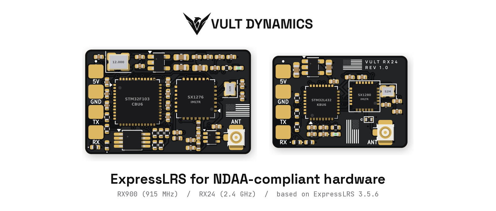
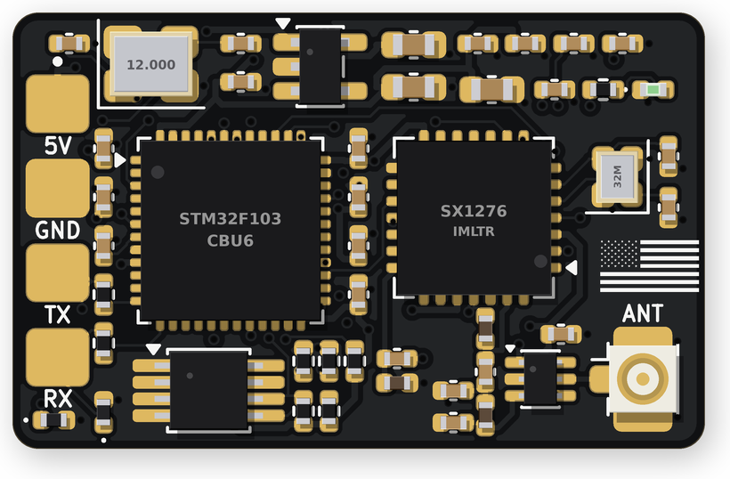
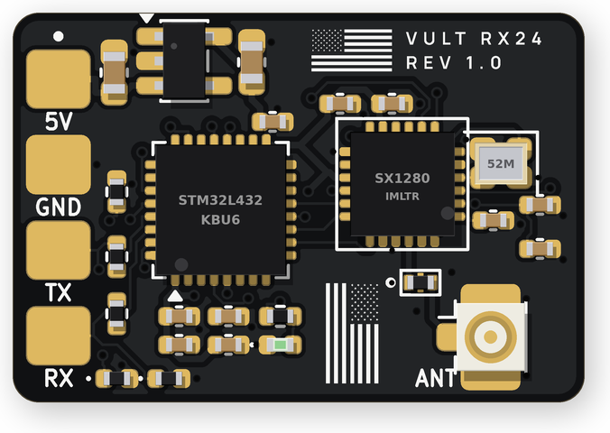

  

  <a href="https://vultdynamics.com">Website</a> ·
  <a href="https://vultdynamics.com/products/rx900">RX900</a> ·
  <a href="https://vultdynamics.com/products/rx24">RX24</a> ·
  <a href="https://github.com/Vult-Dynamics/ExpressLRS/releases">Firmware releases</a> ·
  <a href="mailto:info@vultdynamics.com">Contact</a>

# Vult Dynamics ExpressLRS

This is the Vult Dynamics build of [ExpressLRS](https://github.com/ExpressLRS/ExpressLRS). It lets you run standard ExpressLRS firmware on NDAA-compliant receiver hardware designed and assembled in the USA.

Most ExpressLRS hardware today uses Espressif ESP32 and ESP8285 chips, and current ExpressLRS releases (4.x) only support those. Vult Dynamics receivers use STMicroelectronics STM32 microcontrollers and Semtech radios instead, which keeps covered-country silicon off the board. ExpressLRS 3.5 is the last release line that supports STM32, so this repository keeps that line maintained for Vult hardware.

**Use the `vult/3.5` branch.** It is ExpressLRS 3.5.6 plus the Vult receiver targets, and nothing else. Every Vult release is a signed tag (`vult-*`) built from this branch.

## Products

| | Receiver | Band | Radio / MCU | Size |
| --- | --- | --- | --- | --- |
|  | [**Vult RX900**](https://vultdynamics.com/products/rx900) | 902 to 928 MHz | Semtech SX1276 / STM32F103 | 27 x 17 mm |
|  | [**Vult RX24**](https://vultdynamics.com/products/rx24) | 2.4 GHz | Semtech SX1280 / STM32L432 | 22 x 15 mm |

Both receivers connect to a flight controller through four solder pads (5V, GND, TX, RX) using CRSF, and take an antenna on a U.FL connector. The NDAA declaration for these products is available on request.

## Compatibility

- Works with any transmitter running **ExpressLRS 3.x**. ExpressLRS 4.x transmitters do not link with 3.x receivers, so keep your transmitter on 3.x.
- Binding: set the same binding phrase on the transmitter and receiver, or power-cycle the receiver three times to enter bind mode.
- Betaflight, INAV and ArduPilot: set the receiver UART to Serial RX with the CRSF protocol.

## Flashing and updates

Vult receivers ship with firmware installed. To update:

1. Download the latest release for your receiver from [Releases](https://github.com/Vult-Dynamics/ExpressLRS/releases).
2. Check the file against the published SHA-256 hash and signature in the release notes.
3. Flash it through your flight controller using the [ExpressLRS Configurator](https://github.com/ExpressLRS/ExpressLRS-Configurator/releases) (Betaflight passthrough), with the receiver connected to the flight controller.

## What is in this repository

| Branch or tag | Purpose |
| --- | --- |
| `vult/3.5` (default) | Vult maintained branch: ExpressLRS 3.5.6 plus Vult targets |
| `vult-*` tags | Signed Vult firmware releases |
| `master` | Untouched copy of upstream ExpressLRS, kept for reference |

## Credits and license

ExpressLRS is developed by the ExpressLRS team and community. This fork is maintained by Vult Dynamics LLC and is not affiliated with or endorsed by the ExpressLRS project. Please send questions about Vult hardware to [info@vultdynamics.com](mailto:info@vultdynamics.com), not to the ExpressLRS team.

ExpressLRS and this fork are licensed under the [GNU General Public License v3.0](LICENSE). The complete source code for all firmware Vult Dynamics ships is published here, and you are free to build and flash your own modified versions.
